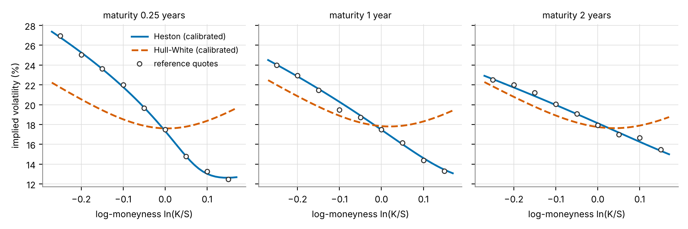
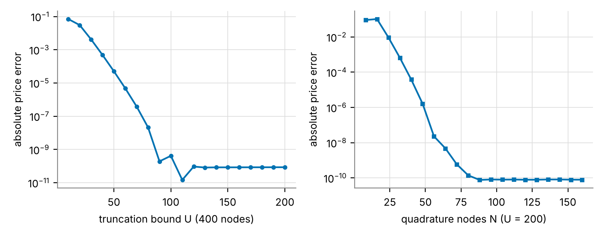
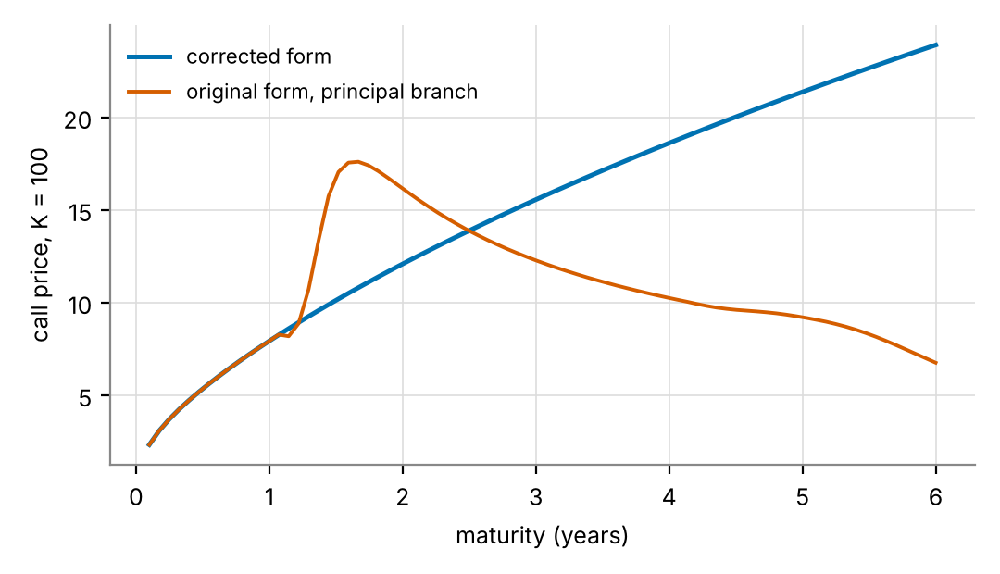

# Hull-White and Heston stochastic volatility models

[](https://github.com/nihalgowda2002-arch/heston-hull-white/actions/workflows/tests.yml)

This repository holds the code behind my MSc Mathematical Finance dissertation at the University of York (2026), *Stochastic Volatility Models: A Self-Contained Development and Comparison of the Hull-White and Heston Models*. The code is organised as a small, tested Python package. It does four things:

- prices European options under both models;
- simulates the Heston variance with two schemes that keep it non-negative;
- calibrates both models to the same implied-volatility surface;
- reproduces every table and figure of the numerical chapter.

Every number in the tables below matches the dissertation to the printed digit, except the timings, which depend on the hardware.

## What the numbers show

- **The skew needs correlation.** Calibrated to the same 27 quotes:
  - Heston fits to within 0.235 volatility points, against a noise level of 0.200.
  - Hull-White cannot get below 2.991. Its noises are independent, so its smile is symmetric about the money, and the optimiser pushes its volatility of variance to the edge of the search region. That is an attempt to buy curvature, which cannot become slope.
- **The branch of the complex logarithm matters.** Heston's original characteristic function, evaluated on the principal branch, prices a two-year at-the-money call at 17.99 against a true value of 12.08. The corrected form agrees with Monte Carlo to within about one standard error at every point tested.
- **The Feller condition fails at the calibrated parameters** (2&kappa;&nu;&#771; = 0.140 against &eta;&sup2; = 0.295), so the variance can touch zero. The simulators therefore have to respect that boundary; both schemes used here do.
- **Fourier pricing is fast.** One Heston price by Gil-Pelaez inversion takes a fraction of a millisecond, about twenty thousand times faster than Monte Carlo on the same machine.

## Quick start

```bash
pip install -r requirements.txt
pytest -q                      # 13 tests, about two seconds
python scripts/reproduce.py    # all tables and figures, about three minutes
```

```python
from svpricing.heston import heston_call

heston_call([90, 100, 110], 1.0, kappa=2.0, nubar=0.04, eta=0.5, rho=-0.7,
            nu0=0.03, S0=100.0, r=0.02)
# array([14.78158627,  7.92217817,  3.16759721])
```

## Repository layout

| File | Contents | Dissertation |
|---|---|---|
| `svpricing/blackscholes.py` | Black-Scholes call and a vectorised implied-volatility solver | (2.4) |
| `svpricing/heston.py` | Characteristic function in the original and corrected forms, Gil-Pelaez inversion by Gauss-Legendre quadrature, a put from its own inversion, and a fine-grid rule for the discontinuous original form | Prop. 4.5, Rem. 4.13 and 4.14, (5.2) |
| `svpricing/hullwhite.py` | Hull-White price as the Black-Scholes price averaged over the average variance, with exact steps for the lognormal variance and common random numbers | Prop. 3.9, (5.3) |
| `svpricing/simulation.py` | Full-truncation Euler, Andersen's quadratic-exponential scheme, exact square-root moments, Heston Monte Carlo | (5.4), (5.5) |
| `svpricing/calibration.py` | Synthetic reference surface, implied-volatility objective, differential evolution followed by trust-region least squares | (5.6), (5.7) |
| `scripts/reproduce.py` | Writes Tables 5.1 to 5.5 to `results/` and Figures 5.1 to 5.3 to `figures/` | Chapter 5 |
| `tests/test_pricing.py` | Limits, parity, martingale property, branch cut, Monte Carlo agreement, calibration recovery | Sections 5.2, 5.3, 5.6 |

Throughout, S = 100 and r = 0.02.

## Reproduced results

### Validation (Sections 5.2 and 5.3)

| Check | Result |
|---|---|
| Heston price as the volatility of variance tends to zero (K = 100, &tau; = 1) | 8.481474, 8.481354, 8.481317 at &eta; = 10&#8315;&sup2;, 10&#8315;&sup3;, 10&#8315;&#8308;, against Black-Scholes at the average variance 8.481313 |
| Hull-White price as the volatility of variance tends to zero | 8.915968 against Black-Scholes 8.916037 (Monte Carlo error 5 &times; 10&#8315;&#8309;) |
| Put-call parity, put priced from its own pair of inversions | holds to about 10&#8315;&sup1;&#8308; across strikes 70 to 130 |
| Variance at T = 1 with the Feller condition failing: exact mean and variance | 0.038647 and 0.002308 |
| Full-truncation Euler, 400,000 paths, 200 steps | 0.038685 and 0.002328, no negative values |
| Andersen QE, 400,000 paths, 200 steps | 0.038656 and 0.002310, no negative values |

### Table 5.1: calibration to the synthetic surface

The surface is generated from Heston at known parameters at three maturities (0.25, 1 and 2 years) and nine log-moneyness values from -0.25 to 0.15. Each implied volatility then gets independent noise of 0.2 volatility points. The fit runs differential evolution (45 generations) and then least squares.

| | &kappa; | &nu;&#771; | &eta; | &rho; | &nu;&#8320; |
|---|---|---|---|---|---|
| generating value | 1.500 | 0.0450 | 0.550 | -0.750 | 0.0320 |
| calibrated value | 1.614 | 0.0433 | 0.543 | -0.755 | 0.0321 |

The RMSE is 0.235 volatility points, which is at the noise floor. Mean reversion &kappa; is the least identified parameter: a faster reversion can be offset by a lower long-run variance, so the product &kappa;&nu;&#771; is recovered far more accurately than either factor alone.

### Table 5.2: error by moneyness, in volatility points

| Moneyness | Quotes | Heston RMSE | Heston bias | Hull-White RMSE | Hull-White bias |
|---|---|---|---|---|---|
| In the money | 15 | 0.262 | +0.016 | 2.559 | -2.093 |
| At the money | 3 | 0.146 | +0.002 | 0.237 | +0.086 |
| Out of the money | 9 | 0.208 | -0.022 | 3.989 | +3.461 |
| All | 27 | 0.235 | | 2.991 | |

The Hull-White bias swings from -2.09 to +3.46 across the strike range. That is the signature of a symmetric curve fitted to a sloped one.

Re-running the Hull-White calibration from scratch gives a volatility of variance of 2.0, again at its bound, and an RMSE of 2.990. It sits at a slightly different point along a flat direction of the objective, where a higher initial variance offsets a lower drift (`results/hull_white_calibration.md`).

### Table 5.3: cost of one price

| Method | Fit RMSE | This machine | Dissertation (Google Colab) |
|---|---|---|---|
| Heston, Fourier inversion | 0.235 | 0.15 ms | 0.37 ms |
| Heston, Monte Carlo (200,000 paths, 400 steps) | | 2.9 s | 6.1 s |
| Hull-White, Monte Carlo (200,000 paths, 200 steps) | 2.991 | 0.7 s | 2.8 s |

### Table 5.4: the two branches of the logarithm

Parameters: &kappa; = 2, &nu;&#771; = 0.04, &eta; = 0.5, &rho; = -0.7, &nu;&#8320; = 0.03.

| K | &tau; | Original form | Corrected form | Monte Carlo (s.e.) |
|---|---|---|---|---|
| 100 | 0.5 | 5.3013 | 5.3013 | 5.2929 (0.0141) |
| 100 | 1.0 | 7.9222 | 7.9222 | 7.9123 (0.0211) |
| 100 | 2.0 | **17.9913** | 12.0753 | 12.0461 (0.0330) |
| 100 | 3.0 | **18.8853** | 15.5001 | 15.4749 (0.0437) |
| 100 | 5.0 | **19.0734** | 21.1954 | 21.1724 (0.0628) |
| 120 | 3.0 | **3.3986** | 6.7164 | 6.7042 (0.0294) |
| 80 | 5.0 | **35.8547** | 33.0960 | 33.0664 (0.0747) |

The two forms agree at short maturities, so a test suite covering only short-dated options would pass. The original form's integrand jumps where the logarithm crosses a branch, which is why it is priced here on a fine uniform grid: no fixed-order quadrature converges on it.

### Table 5.5: Fourier against Monte Carlo

| K | &tau; | Fourier | Monte Carlo | Standard error |
|---|---|---|---|---|
| 90 | 1.0 | 14.7816 | 14.7712 | 0.0277 |
| 100 | 1.0 | 7.9222 | 7.9123 | 0.0211 |
| 110 | 1.0 | 3.1676 | 3.1675 | 0.0137 |
| 100 | 2.0 | 12.0753 | 12.0760 | 0.0331 |
| 120 | 2.0 | 3.6489 | 3.6606 | 0.0186 |

## Figures

**Figure 5.1.** Calibrated smiles against the reference quotes. Heston follows the skew; Hull-White can only produce a symmetric curve.



**Figure 5.2.** Convergence of the Gauss-Legendre inversion. The error falls below 10&#8315;&sup1;&#8304; by U = 100 and N = 80, then sits at the accuracy of the reference computation.



**Figure 5.3.** Call price against maturity from the two forms of the characteristic function, at the calibrated parameters.



## Notes and limitations

- **The reference surface is synthetic.** It is generated from Heston itself, so the calibration tests the implementation and the identifiability of the parameters, not whether Heston fits real market data. The Hull-White result does not depend on this, because its symmetric smile is structural.
- **The setting is deliberately simple.** There are no dividends, the rate is constant, and only European calls and puts are priced.
- **Monte Carlo prices use full-truncation Euler.** The asset is stepped by log-Euler and the variance by full-truncation Euler. Andersen's QE scheme is implemented for the variance and tested against exact moments.
- **Natural extensions:**
  - calibration to a market surface (index options);
  - the Carr-Madan fast Fourier transform for whole strike grids;
  - jumps (Bates);
  - stochastic local volatility;
  - analytic gradients for the calibration.

## References

- Albrecher, H., Mayer, P., Schoutens, W. and Tistaert, J. (2007). The little Heston trap. *Wilmott Magazine*, January, 83-92.
- Andersen, L. (2008). Simple and efficient simulation of the Heston stochastic volatility model. *Journal of Computational Finance* 11(3), 1-42.
- Carr, P. and Madan, D. (1999). Option valuation using the fast Fourier transform. *Journal of Computational Finance* 2(4), 61-73.
- Gatheral, J. (2006). *The Volatility Surface: A Practitioner's Guide*. Wiley.
- Gil-Pelaez, J. (1951). Note on the inversion theorem. *Biometrika* 38(3-4), 481-482.
- Heston, S. L. (1993). A closed-form solution for options with stochastic volatility with applications to bond and currency options. *Review of Financial Studies* 6(2), 327-343.
- Hull, J. and White, A. (1987). The pricing of options on assets with stochastic volatilities. *Journal of Finance* 42(2), 281-300.
- Lord, R., Koekkoek, R. and van Dijk, D. (2010). A comparison of biased simulation schemes for stochastic volatility models. *Quantitative Finance* 10(2), 177-194.
- Romano, M. and Touzi, N. (1997). Contingent claims and market completeness in a stochastic volatility model. *Mathematical Finance* 7(4), 399-412.
- Storn, R. and Price, K. (1997). Differential evolution: a simple and efficient heuristic for global optimization over continuous spaces. *Journal of Global Optimization* 11(4), 341-359.

## Licence

MIT. See `LICENSE`.
